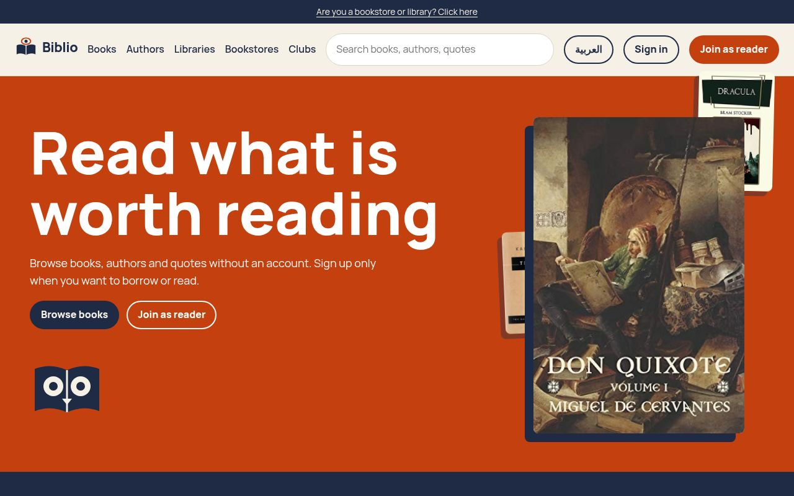
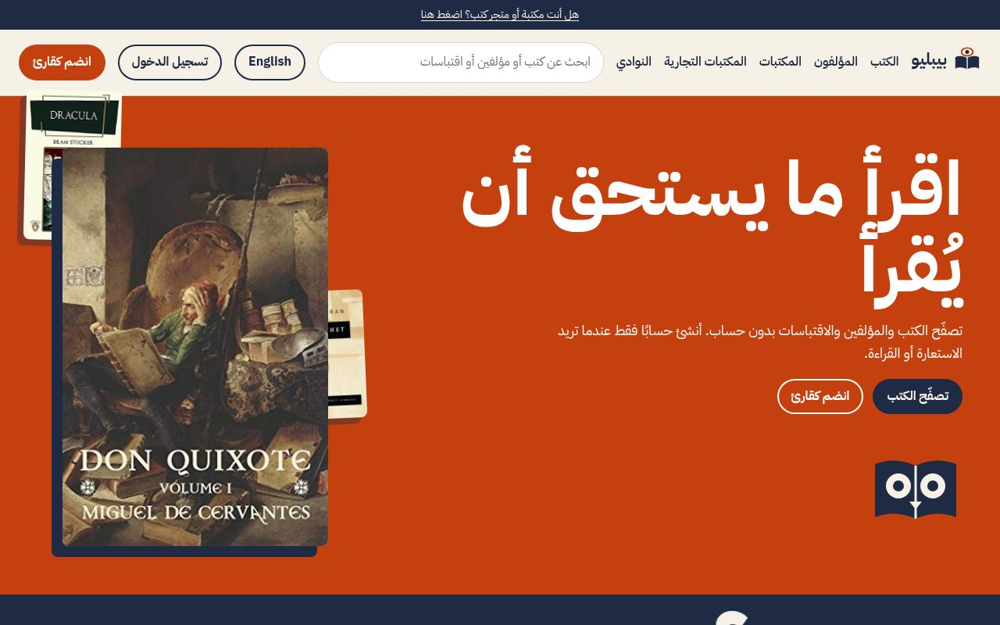
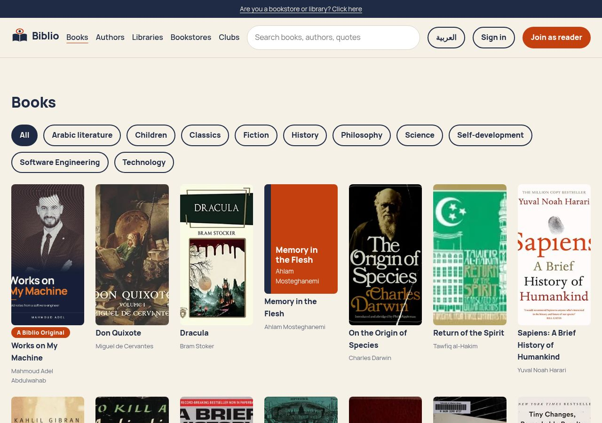
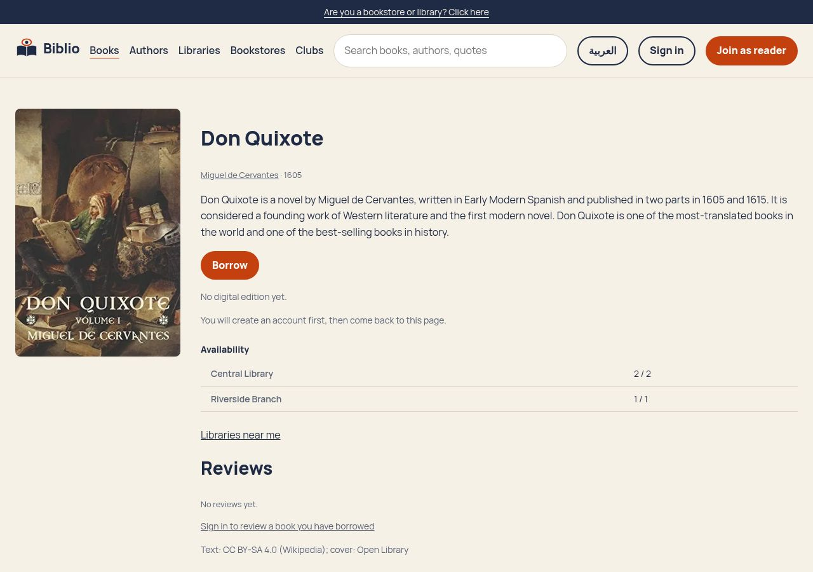
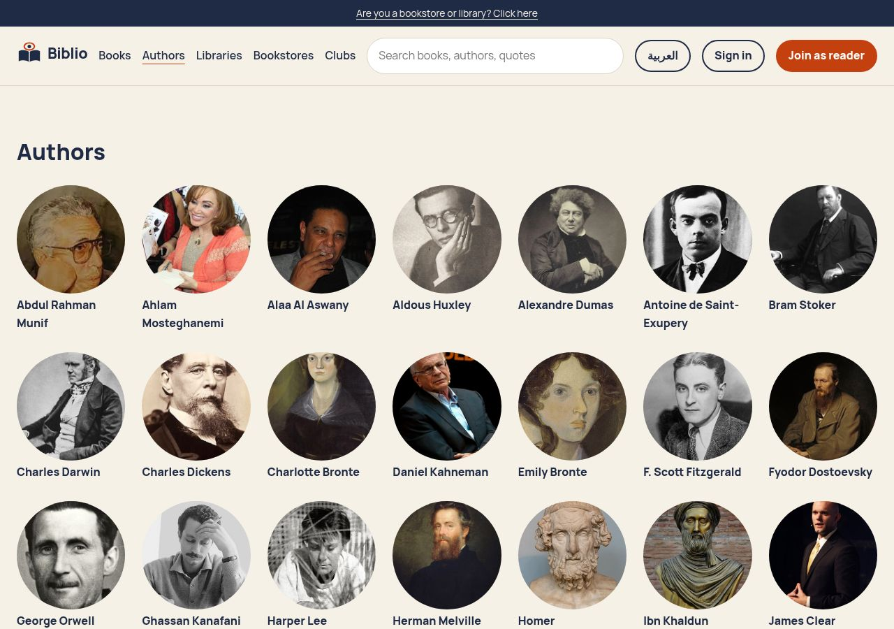
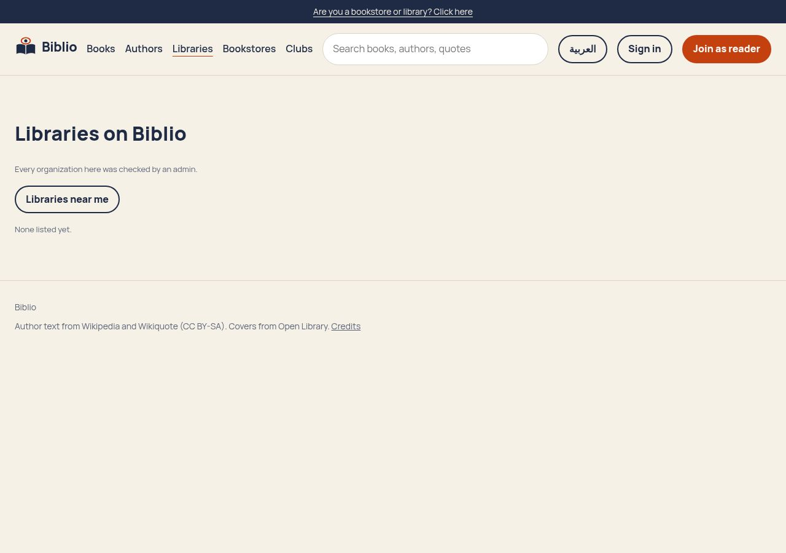

# Biblio

A bilingual (English and Arabic, full RTL) library platform: browse books, authors and libraries without an account, and borrow from verified libraries once you join.

**Live:** https://biblio-lms.pages.dev

## Screenshots

| Home (desktop) | Home (mobile) | Home (Arabic) |
| --- | --- | --- |
|  |  |  |

| Books | Book page |
| --- | --- |
|  |  |

| Authors | Libraries |
| --- | --- |
|  |  |

## Features

- English and Arabic with full right-to-left layout
- Public browsing of books, authors, quotes and libraries, no login needed
- Members borrow from any verified library
- Reader for public-domain books
- Responsive down to 390px, respects reduced motion

## Stack

React 18, TypeScript, Vite, React Router, plain CSS.

## Run locally

```bash
cp .env.example .env   # set VITE_API_URL to your API
npm install
npm run dev
```

```bash
npm run build          # type-check and bundle into dist/
```
